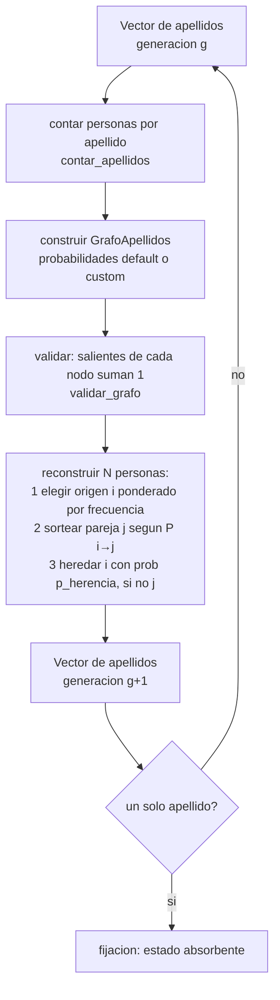

# Modelo estacionario como grafo dirigido de apellidos

Este documento describe el **modelo estacionario** (población de tamaño
constante) de evolución y extinción de apellidos, reconstruido como un **grafo
dirigido**. El motor del grafo está en
[`src/graphModel.jl`](../src/graphModel.jl), la simulación de alto nivel en
[`src/stacional-model.jl`](../src/stacional-model.jl), y se ejecuta desde
[`scripts/run_stacional_model.jl`](../scripts/run_stacional_model.jl).

A diferencia del proceso de Bienaymé–Galton–Watson (ver
[`docs/justificacion-teorica.md`](justificacion-teorica.md)), donde se modela un
**único apellido** que puede crecer o extinguirse, aquí conviven **varios
apellidos** y el tamaño total de la población **se conserva en cada
generación**.

## 1. Idea del modelo

- La población tiene un tamaño fijo `N` que **no cambia** entre generaciones.
- Se modela como un **grafo dirigido** con `n` vértices, uno por apellido:
  - Cada **vértice** `i` guarda cuántas personas tienen ese apellido en la
    generación actual (su *conteo*).
  - Cada **arista dirigida** `i → j` lleva la **probabilidad** de que una
    persona de apellido `i` se reproduzca con una de apellido `j`. Las aristas
    son dirigidas: `P(i → j)` y `P(j → i)` pueden ser distintas.
  - Existe el **auto-lazo** `i → i`: la probabilidad de reproducirse con alguien
    del propio apellido.
- Como el tamaño total no cambia y en cada generación la población se reconstruye
  a partir de los apellidos existentes, la **diversidad de apellidos nunca
  aumenta**: solo puede mantenerse o disminuir. El proceso avanza hacia la
  **fijación** de un único apellido, que es un **estado absorbente**.

Esto es análogo a la **deriva genética**: por el azar del muestreo, una
población finita termina perdiendo variantes hasta quedarse con una sola. El
modelo plano anterior (emparejamiento uniforme por bloques) es exactamente el
caso particular de este grafo cuando es **completo** y las probabilidades son
**proporcionales** a los conteos.

## 2. Probabilidad de las aristas (modo por defecto: proporcional)

Por defecto, la probabilidad de la arista `i → j` se calcula de forma
**proporcional** al conteo del apellido destino `j`, usando como denominador la
suma de conteos de los apellidos **compatibles** con `i`:

```
P(i → j) = conteos[j] / (Σ conteos[c]  para todo c compatible con i)
```

En un **grafo completo** (todos compatibles con todos), el denominador es el
total de la población, así que todas las filas coinciden.

### Ejemplo

Apellidos `A = 3` personas, `B = 2`, `C = 2` (total `7`), grafo completo. Desde
cualquier nodo:

| Arista | Probabilidad |
| ------ | ------------ |
| `→ A`  | `3/7 ≈ 0.429` |
| `→ B`  | `2/7 ≈ 0.286` |
| `→ C`  | `2/7 ≈ 0.286` |
| **Suma** | **1.0** |

La fórmula incluye el **auto-lazo**: `P(A → A) = 3/7`.

### Compatibilidad restringida

Si un apellido `i` solo puede reproducirse con un **subconjunto** de apellidos
(`compatibles[i]`), el denominador usa solo ese subconjunto. Por ejemplo, si `A`
solo es compatible con `A` y `B` (`3 + 2 = 5` personas):

```
P(A → A) = 3/5 = 0.6     P(A → B) = 2/5 = 0.4     (no existe arista A → C)
```

## 3. Validación del grafo

Para cualquier grafo (default o custom), [`validar_grafo`](../src/graphModel.jl)
exige que:

- Las probabilidades salientes de **cada** vértice sumen `1.0` (con tolerancia
  `1e-5`).
- No haya probabilidades **negativas**.

Si alguna condición falla, se lanza un error explícito indicando el vértice y la
suma encontrada.

## 4. Dinámica de una generación

El motor es **estocástico** y conserva el tamaño `N`. Para construir cada una de
las `N` personas de la siguiente generación:

1. Se elige un apellido **origen** `i` al azar, **ponderado por la frecuencia**
   de cada apellido en la generación actual (quién inicia el emparejamiento).
2. Se sortea la **pareja** `j` según la distribución saliente `P(i → j)` del
   grafo.
3. El hijo **hereda** el apellido del origen `i` con probabilidad `p_herencia`,
   o el de la pareja `j` con probabilidad `1 - p_herencia`.

Así, el **destino `j` de la arista sí influye** en la herencia: cuando
`P(i → j)` es alta, el origen `i` se empareja con frecuencia con `j` y parte de
su descendencia hereda `j`. En grafos **asimétricos** (`P(i → j) ≠ P(j → i)`)
esto produce flujos de apellidos dirigidos.

### El parámetro `p_herencia`

El default `p_herencia = 0.5` tiene una lectura biológica: el origen del
emparejamiento es hombre o mujer con igual probabilidad y el apellido lo
transmite el hombre, así que la mitad de las veces el hijo hereda el apellido
del origen y la otra mitad el de la pareja. Ajustarlo permite experimentar:

- `p_herencia = 1.0`: el hijo siempre hereda el origen `i` (el destino no
  influye en la herencia; equivale al comportamiento anterior).
- `p_herencia = 0.0`: el hijo siempre hereda la pareja `j`.
- valores intermedios: sesgo configurable entre ambos.



## 5. Mapeo al código

| Concepto del modelo                  | Elemento en el código                                   |
| ------------------------------------ | ------------------------------------------------------- |
| Estado de la población               | `Vector{Int}` de ids de apellido                        |
| Grafo de la generación               | `GrafoApellidos` (`src/graphModel.jl`)                  |
| Conteo de personas por apellido      | `contar_apellidos(poblacion)`                           |
| Probabilidades por defecto           | `probabilidades_proporcionales(grafo)`                  |
| Consultar aristas salientes de `i`   | `probabilidades_salientes(grafo, i)`                    |
| Validar el grafo                     | `validar_grafo(grafo)`                                  |
| Una transición de generación         | `siguiente_generacion_grafo(poblacion, rng; ...)`       |
| Parámetros de la simulación          | `struct ParametrosModelo`                               |
| Simulación hasta fijación/límite     | `simular_fijacion(estado_inicial; ...)`                 |

### `GrafoApellidos`

```julia
# A partir de una población; grafo completo y probabilidades proporcionales.
grafo = GrafoApellidos([1, 1, 1, 2, 2, 3, 3])

grafo.apellidos                        # [1, 2, 3]
grafo.conteos                          # Dict(1 => 3, 2 => 2, 3 => 2)
probabilidades_salientes(grafo, 1)     # Dict(1 => 3/7, 2 => 2/7, 3 => 2/7)
validar_grafo(grafo)                   # true
```

### `ParametrosModelo`

| Campo                  | Tipo                        | Por defecto | Significado                                                                 |
| ---------------------- | --------------------------- | ----------- | --------------------------------------------------------------------------- |
| `max_generaciones`     | `Int`                       | `1000`      | Tope de seguridad de generaciones antes de rendirse si no hay fijación.     |
| `fijar_probabilidades` | `Function` o `Nothing`      | `nothing`   | Estrategia para calcular probabilidades custom cada generación (ver §6).    |
| `p_herencia`           | `Float64`                   | `0.5`       | Probabilidad de que el hijo herede el apellido del origen `i` (ver §4).     |

```julia
# Por defecto (probabilidades proporcionales, herencia 50/50).
p = ParametrosModelo()

# Tope de 200 generaciones.
p = ParametrosModelo(max_generaciones = 200)

# El hijo siempre hereda el apellido del origen (el destino no afecta la herencia).
p = ParametrosModelo(p_herencia = 1.0)
```

### `simular_fijacion(estado_inicial; parametros, rng)`

Itera `siguiente_generacion_grafo` hasta que quede **un único apellido** o se
alcance `max_generaciones`. Devuelve una *named tuple*:

| Campo          | Significado                                                       |
| -------------- | ---------------------------------------------------------------- |
| `ganador`      | Id del apellido fijado, o `nothing` si no hubo fijación.         |
| `generaciones` | Número de transiciones simuladas.                                |
| `historial`    | Vector con el estado completo de cada generación.                |
| `fijacion`     | `true` si se alcanzó un único apellido.                          |

Invariantes garantizadas (verificadas en los tests):

- `length(historial) == generaciones + 1`.
- Todos los estados del `historial` tienen el mismo tamaño que `estado_inicial`.
- La diversidad nunca aumenta (los apellidos de cada generación son un
  subconjunto de los de la anterior).
- Si `fijacion == true`, todo el estado final es igual a `ganador`.

## 6. Probabilidades personalizadas (API abierta)

Además del modo por defecto, puedes definir el grafo a mano. Hay dos vías.

### a) Construir un `GrafoApellidos` con probabilidades custom

Útil para aristas **asimétricas** (`P(i → j) ≠ P(j → i)`). El grafo se valida
con `validar_grafo`:

```julia
poblacion = [1, 2]
probs = Dict(
    1 => Dict(1 => 0.8, 2 => 0.2),   # desde el apellido 1
    2 => Dict(1 => 0.1, 2 => 0.9),   # desde el apellido 2 (asimétrico)
)
grafo = GrafoApellidos(poblacion; probabilidades = probs)
validar_grafo(grafo)   # true
```

También puedes restringir la compatibilidad con `compatibles`:

```julia
compatibles = Dict(1 => [1, 2], 2 => [2, 3], 3 => [1, 2, 3])
grafo = GrafoApellidos([1, 1, 1, 2, 2, 3, 3]; compatibles = compatibles)
```

### b) Inyectar una estrategia por generación con `fijar_probabilidades`

Si quieres recalcular las probabilidades en **cada** generación según el estado
actual, pasa una función a `ParametrosModelo`. Debe recibir la población actual
y devolver un `Dict{Int,Dict{Int,Float64}}` válido:

```julia
function mi_estrategia(poblacion_actual::Vector{Int})
    # ... construir y devolver Dict{Int, Dict{Int, Float64}} ...
end

parametros = ParametrosModelo(max_generaciones = 200,
                              fijar_probabilidades = mi_estrategia)
```

Si `fijar_probabilidades === nothing` (por defecto), se usa el cálculo
proporcional derivado de los conteos.

## 7. Ejecutar la simulación

Desde la raíz del proyecto:

```powershell
julia --project=. scripts/run_stacional_model.jl
```

La salida muestra el grafo de la generación 0 (conteos y tabla de
probabilidades, con cada fila sumando 1), la evolución de los linajes generación
por generación, y el resultado final (fijación y apellido ganador, o límite
alcanzado).

Puedes configurar la ejecución con variables de entorno (tienen prioridad):

```bash
SEMILLA=7 POBLACION_INICIAL="1,1,2,2,3,3" MAX_GENERACIONES=100 \
    julia --project=. scripts/run_stacional_model.jl
```

| Variable            | Por defecto      | Significado                                                        |
| ------------------- | ---------------- | ----------------------------------------------------------------- |
| `POBLACION_INICIAL` | `1,1,2,2,3,3,4,4`| Estado inicial: ids de apellido separados por comas.              |
| `MAX_GENERACIONES`  | `100`            | Tope de seguridad de generaciones.                                |
| `SEMILLA`           | aleatoria        | Entero para reproducibilidad, o `nothing` (azar).                 |

Con la misma `SEMILLA`, dos ejecuciones producen exactamente el mismo historial.

## 8. Ejecutar los tests

```powershell
julia --project=. test/test_grafo.jl
```

Los tests (en [`test/test_grafo.jl`](../test/test_grafo.jl)) cubren:

1. **Estructura y conteo**: vértices únicos, conteos correctos y compatibilidad
   default (grafo completo).
2. **Probabilidades proporcionales**: el ejemplo `A=3, B=2, C=2` (`3/7, 2/7,
   2/7`), suma 1 por nodo y el caso de compatibilidad restringida.
3. **Validación y custom**: grafos válidos pasan; suma `≠ 1` o probabilidades
   negativas lanzan error; probabilidades asimétricas custom.
4. **Transición estocástica**: tamaño constante, diversidad no aumenta, estado
   absorbente y reproducibilidad con la misma semilla.
5. **Herencia por pareja**: que el destino `j` influye en la herencia, los
   extremos de `p_herencia` (`0.0` y `1.0`) y la validación de su rango.
6. **`simular_fijacion`**: convergencia a fijación y estructura del historial.

## 9. Notas y limitaciones

- La diversidad de apellidos **solo puede disminuir**: el modelo no incorpora
  mutación ni aparición de apellidos nuevos.
- Para poblaciones pequeñas la fijación es prácticamente segura con un tope de
  generaciones amplio.
- La herencia usa un único parámetro `p_herencia` (origen vs. pareja). Modelar
  explícitamente el **sexo** de cada individuo, o reglas de transmisión más
  ricas (apellidos compuestos, dobles apellidos), es un posible siguiente paso.
